<p align="center">
  
</p>

<p align="center">
  
  
  
  
</p>

---

## What it is

When you open or clone a repo, Claude Code can **auto-load configuration it ships** — and that configuration can run programs on your computer:

- **`.mcp.json`** defines "MCP servers." Some connect to a website; others **run a program on your machine** the moment Claude loads, at your own user privilege.
- **`.claude/settings.json`** can define **hooks** (commands that run by themselves on events) and **permission allow-rules** (commands Claude runs *without asking you*).
- **`.claude-plugin/`** and **`hooks/hooks.json`** can register the same auto-running hooks.

So a repo from the internet can run code just because you opened it. **config-guard** stops that by **quarantine** — it physically moves the config aside so nothing loads until you've read a plain-English report and approved it. It blocks by *moving files*, not by using Claude Code hooks, so it works in the VS Code extension too (where command-hooks don't fire).

---

## How it works

<p align="center">
  
</p>

`guard` moves risky config aside and writes a report. You read it. `approve` restores what you trust and remembers it by content fingerprint — so if a file **changes** later, it gets blocked again automatically. `scan` does the same report read-only, moving nothing.

---

## Install

config-guard is a self-contained Claude Code **skill** — Claude Code auto-discovers it, with **no configuration and no build step**. Clone it into your skills directory:

```bash
git clone https://github.com/Claude-Booster/config-guard.git ~/.claude/skills/config-guard
```

That's the whole install. The engine lives inside the skill at [`scripts/config_guard.py`](scripts/config_guard.py); the next time Claude Code runs, ask it to *"scan this repo"* or *"is this safe to open?"* and the skill activates.

### Requirements

| Tool | Needed for | If missing |
|------|-----------|------------|
| **Python 3.10+** — standard library only, no `pip install` | Everything | The tool can't run |

No third-party packages, no network calls, no services. The one external dependency is a Python interpreter on your `PATH`.

---

## Usage

Run the four commands directly, or just ask Claude (the skill wraps them). Quote any path with spaces.

```bash
# look, don't touch — read-only report of any repo / plugin / tool
python scripts/config_guard.py scan    "C:/path/to/thing"

# block new/untrusted config until you review it
python scripts/config_guard.py guard   "C:/path/to/new-repo"

# after reviewing, unblock + remember the approval
python scripts/config_guard.py approve "C:/path/to/new-repo"

# see what's blocked vs approved
python scripts/config_guard.py status
```

**The typical flow for something new:** `guard` it → read the report → `approve` it if you trust it → open it in Claude Code. If you don't trust it, leave it blocked (or delete it).

---

## Reading the report

Every finding has a risk level and a *"What to check"* line:

| Risk | Means |
|------|-------|
| 🔴 **HIGH** | Can run code/commands on your machine — a program an `.mcp.json` launches, a hook that auto-runs a command, or a permission rule that pre-approves commands. Read these before approving. |
| 🟠 **MEDIUM** | External connections or hidden settings — an MCP server that calls a website, or settings that set environment variables. |
| 🟢 **LOW** | Adds instructions Claude can load — skills, agents, slash-commands. Usually harmless; skim them. |

The report opens with a one-line **verdict** and counts, then lists findings grouped HIGH → MEDIUM → LOW.

---

## What it detects

It walks the target and flags every `.mcp.json`, `.claude/` directory, `.claude-plugin/` directory, and `hooks/hooks.json`, skipping `node_modules`, `.git`, caches, and already-quarantined items. `.mcp.json` servers are classified by whether they run a local command (HIGH) or call a remote service (MEDIUM), and by whether they request credentials. Settings files are flagged for hooks, permission allow-rules, and auto-enable switches. Malformed/unreadable config is treated as **suspicious**, never benign.

---

## Where things live

| Thing | Location |
|-------|----------|
| The engine | `scripts/config_guard.py` (inside this skill) |
| Tests | `scripts/test_config_guard.py` |
| Approval ledger | `~/.claude/config-guard/ledger.json` (override with `CONFIG_GUARD_HOME`) |
| Saved reports | `~/.claude/config-guard/reports/` |
| Quarantined items | renamed in place: `<name>.cfgguard-quarantine` next to the original |

---

## Safety & reversibility

- **The tool never executes anything from the target.** It only *reads* text/JSON and *moves* files. (Tests invoke it with `python -I` to confirm.)
- **Quarantine is fully reversible.** `approve` restores the exact files; to undo by hand, rename `<name>.cfgguard-quarantine` back (drop the suffix).
- **Pair it with Claude Code's own prompt.** Keep `enableAllProjectMcpServers` unset so Claude still asks before enabling a repo's MCP servers. config-guard is the belt; that prompt is the suspenders.

---

## Contributing

To *use* the skill you need nothing below — the clone above is enough. For changes, run the test suite from the skill folder:

```bash
cd scripts && python -m unittest -v
```

Tests build a temp fixture repo, then assert the full lifecycle: `scan` moves nothing, `guard` quarantines, `approve` restores, re-`guard` leaves approved items alone, and a changed file gets re-quarantined.
